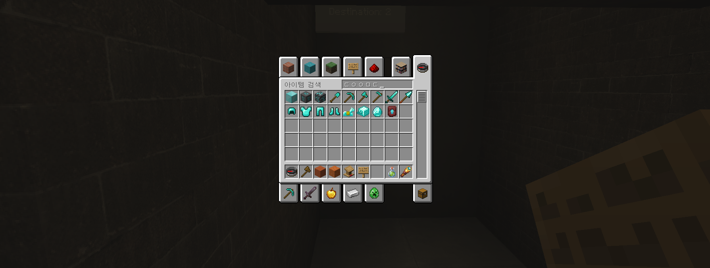

# Hangul 한글


Minecraft Java Edition의 한글 입력을 다듬는 가벼운 클라이언트 모드입니다. 입력 모드를 별도로 관리하게 만들기보다, 평소 Windows 입력 방식이 게임 안에서도 자연스럽게 이어지도록 설계했습니다. 로더별 지원 버전과 검증 범위는 [호환성 문서](docs/COMPATIBILITY.md)를 참고해 주세요.

Lightweight native Korean (Hangul) IME input and Korean-aware search for Minecraft chat, books, signs, commands, items, recipes, and Hanja conversion.

공식 프로젝트명과 모드 ID는 `Hangul`과 `hangul`입니다. `Hangeul`과 `hangeul`은 검색 및 이전 식별자 호환을 위한 별칭으로 지원합니다.

[Modrinth에서 다운로드](https://modrinth.com/mod/hangul) · [소스 코드](https://github.com/tdbgo/Hangul) · [문제 신고](https://github.com/tdbgo/Hangul/issues)

최신 공개 파일은 `1.3.0-beta.10`입니다. Windows 전각 영문 대응 옵션과 REI 입력창의 조합 표시를 제공합니다. Fabric·Quilt는 Minecraft 26.4 Snapshot 3까지, NeoForge·Forge는 26.3까지 지원합니다. 완료된 검사와 실제 입력기 확인 범위는 [검증 기록](docs/RELEASE_READINESS.md)에 정리합니다.

| 로더 | 최신 파일 버전 | 지원 범위 |
| --- | --- | --- |
| Fabric·Quilt | 1.3.0-beta.10 | 26.1–26.3 및 명시된 시험판, 26.4 Snapshot 1–3 |
| NeoForge | 1.3.0-beta.10 | 26.1, 26.1.1, 26.1.2, 26.2, 26.3 |
| Forge | 1.3.0-beta.10 | 26.1, 26.1.1, 26.1.2, 26.2, 26.3 |

모든 로더가 같은 릴리스 번호를 가질 필요는 없습니다. 실행 코드가 달라진 파일만 새로 배포합니다. 버전 번호·지원 선언·리소스만 바뀐 파일은 새로 올리지 않으며, 지원 선언은 다음 코드 업데이트에 함께 반영합니다.

### 개발 버전: beta.11

26.4 Snapshot 4·5의 입력창 렌더링과 새 표지판 입력줄에 대응하고 있습니다. 최신 NeoForge·Forge 및 시험판 Fabric Loader도 검증 목록에 추가했습니다. 위 표는 공개 파일의 범위이며, 개발 소스의 추가 지원 목록과 구분합니다.

## 기본 사용법

모드를 설치한 뒤에는 별도의 전환키를 누를 필요가 없습니다.

1. Windows에서 평소처럼 한/영키를 사용합니다.
2. 채팅, 책, 표지판, 명령어 블록 등 원하는 입력창에 입력합니다.
3. 조합 중인 글자가 커서 위치에 즉시 표시되고, 확정되면 정상 입력값으로 들어갑니다.

`F6`은 OS IME가 고장 난 환경에서 단일행 입력창에만 쓰는 비상용 **강제 한글 모드**입니다. 현재 입력창에서만 적용되며, 다시 `F6`을 누르거나 다른 곳으로 포커스를 옮기거나 화면을 닫으면 **자동 입력 [IME]** 모드로 돌아갑니다. 책과 표지판은 기본 OS IME 경로를 사용하고 F6 전환은 지원하지 않습니다. 오른쪽 Alt/한영키는 모드가 가로채지 않습니다.

### 전각 영문 대응

Windows 한국어 입력기에서 `ａｂｃ１２３`처럼 전각 영문·숫자가 나오는 경우를 위한 선택 기능입니다. 입력창에서 `F7`로 반각 상태 복구를 요청하고, `Shift+F7`로 반각 영문 유지를 켜거나 끌 수 있습니다. 기본값은 꺼짐이며 설정은 `config/hangul.properties`에 저장합니다.

한국어 IME의 영문 상태에서만 동작합니다. 조합·한자 후보 선택 중에는 건드리지 않고, 한영 상태·입력 중인 문장·커서·붙여넣기도 바꾸지 않습니다. 입력기가 상태 조회를 지원하지 않거나 다른 언어를 사용 중이라면 원래 입력을 그대로 전달합니다. 전각 문장부호·공백·일본어·중국어 문자는 일괄 변환하지 않습니다.

입력기별 동작 범위와 확인 방법은 [전각 입력 대응](docs/IME_WIDTH.md)을 참고해 주세요.

## 입력 구조

- 기본값은 OS IME 자동 추종
- Minecraft 26.1+의 IME preedit 이벤트를 입력줄 안에 직접 합성 렌더링
- 단일행 조합 문자열에는 밑줄과 실제 IME 커서 위치 표시
- 조합 중에는 실제 `EditBox` 값과 서버 명령어 추천 패킷을 변경하지 않음
- 문자 확정 시에만 바닐라 입력 경로로 값 반영
- 커서 중간 입력과 선택 영역 교체를 시각적으로 지원
- 책과 같은 자동 줄바꿈·다중행 편집기에서 인라인 조합 지원
- 표지판의 각 줄과 3D 변환된 커서 위치에서 인라인 조합 지원
- 채팅·명령어·명령어 블록·서버 주소 등 바닐라 단일행 입력 지원
- 운영체제 한자 후보창을 현재 게임 커서 위치에 표시
- 창작 인벤토리와 조합법 책에서 초성 검색 지원: `ㄷㅇㅇㅁㄷ` → `다이아몬드`
- 영문 상태로 잘못 입력한 두벌식 검색 복구: `rmarhl` → `금괴`
- 공백으로 떨어진 여러 검색어가 모두 포함된 결과를 찾는 다중 토큰 폴백
- 한글 IME 조합 중인 마지막 글자까지 검색 결과에 즉시 반영
- 한글 상태로 영문 명령어의 물리 키를 누른 경우와 `디버그` 같은 음차 명령의 Tab 추천 복구
- F6 강제 모드에서는 독립 두벌식 조합기 사용
- Fabric API·Mod Menu 의존성, 별도 네이티브 라이브러리 설치 불필요
- Fabric·Quilt·NeoForge·Forge용 빌드 / Java 25 이상 — 로더별 버전과 검증 수준은 [호환성 문서](docs/COMPATIBILITY.md)를 확인해 주세요.

## Hangul의 강점

- **조용한 네이티브 경험:** 정상 동작할 때 상태창이나 별도 전환키를 의식할 필요가 없습니다.
- **입력값 안전성:** 미완성 조합 문자열은 화면에만 보이고 저장값·명령어·서버 패킷에는 확정 후 한 번만 반영됩니다.
- **입력창 전체성:** 채팅뿐 아니라 책, 표지판, 명령어 블록과 한자 후보 위치까지 같은 원칙으로 처리합니다.
- **한국어 탐색:** 초성, 두벌식 자판 실수, 다중 단어, 음차 명령어를 바닐라 검색 구조 위에서 지원합니다.
- **사용자 서버 친화성:** 고정 명령어 번역표가 아니라 서버가 공개한 리터럴을 분석하므로 새 영문 명령에도 적용됩니다.
- **작은 실행 표면:** Fabric API·Mod Menu를 요구하지 않고, 추가 네이티브 DLL 동봉이나 상시 전체 목록 스캔이 없습니다.

검색어: Minecraft 한글 입력, 한글 채팅, 초성 검색, 한글 검색, Korean input, Hangul IME, Hangeul, Korean IME

## 한글 검색 사용법

창작 인벤토리 검색창과 조합법 책에서 다음 입력을 그대로 사용할 수 있습니다.

- `ㄷㅇㅇㅁㄷ`: 이름에 `다이아몬드`처럼 해당 초성이 들어간 항목
- `rmarhl`: 두벌식으로 변환한 `금괴` 검색
- `주괴 철`: 단어 순서와 관계없이 `철 주괴`처럼 두 단어가 모두 들어간 항목

초성은 언어가 바뀌거나 검색 트리가 다시 만들어질 때 한 번 색인됩니다. 매 프레임 전체 아이템을 순회하지 않으며, IME 조합 중 검색도 실제 입력값이나 네트워크 패킷을 변경하지 않습니다.

명령어 입력에서 한글 상태인 줄 모르고 영문 명령어의 물리 키를 누른 경우, `/` 뒤의 한글을 영문 키로 역변환해 현재 서버가 허용한 리터럴 명령을 Tab 후보로 보여 줍니다. `디버그` → `debug`, `메시지` → `message`, `게임모드` → `gamemode`처럼 한글로 음차한 명령도 자음 발음 키가 맞으면 찾습니다. 고정 번역 사전이 아니므로 사용자 서버 명령에도 자동 적용되지만, `날씨` → `weather`처럼 뜻이 다른 단어를 번역하는 기능은 아닙니다.

## 사용 화면

`ㄷㅇㅇㅁㄷ`로 다이아몬드 관련 아이템을 찾는 모습입니다.



채팅 입력 예시입니다.


## 설치

1. 사용 중인 Minecraft 버전에 맞는 로더를 설치합니다. Fabric·Quilt·NeoForge·Forge 중 하나만 선택합니다.
2. [Modrinth](https://modrinth.com/mod/hangul)에서 **현재 공개된 파일의 지원 로더**를 확인하고 Minecraft의 `mods` 폴더에 넣습니다. 개발 중인 빌드의 지원 범위가 기존 공개 파일에 소급 적용되지는 않습니다.
3. 게임을 실행하면 자동 IME 모드로 시작합니다.

멀티로더 빌드에서 `-fabric.jar`는 Fabric·Quilt 공용이며, `-neoforge.jar`와 `-forge.jar`는 각각 해당 로더 전용입니다. 여러 파일을 동시에 넣지 마세요. 서버에는 설치하지 않습니다. 별도 Fabric API나 호환 브리지 모드는 필요하지 않습니다.

## 빌드

```powershell
powershell.exe -NoProfile -ExecutionPolicy Bypass -File .\build.ps1
```

빌드는 Java 25를 선택한 뒤 클린 빌드, 두벌식 조합·검색·명령어 복구 회귀 테스트, 배포 JAR의 바이너리 호환 검사와 실제 Mixin 적용 검사를 수행합니다. 화면을 띄우지 않는 위젯 검사도 포함되지만, Windows IME의 한자 후보창이나 전체화면 동작을 대신 확인하지는 않습니다.

모든 로더의 JAR을 빌드하고 검사하려면 Java 25와 Python 3.11 이상을 준비한 뒤 실행합니다.

```powershell
.\verify-multiloader.ps1 -FullMatrix
```

`-FullMatrix`를 생략하면 기본 대상인 26.2에서 네 로더를 검사합니다. 입력 로직은 공통 소스를 사용하며, 빌드 도구와 검사 코드는 배포 JAR에 포함되지 않습니다.

Fabric·Quilt만 변경한 경우에는 검사 범위를 선택할 수 있습니다.

```powershell
.\verify-multiloader.ps1 -Platforms fabric -FullMatrix
```

검사와 배포는 별개입니다. CI가 모든 로더를 회귀 검사하더라도 모든 파일을 새 릴리스에 올리지는 않습니다. 플랫폼별 버전과 변경 없는 파일의 재배포 차단 절차는 [릴리스 체크리스트](docs/RELEASE_CHECKLIST.md)를 따릅니다.

NeoForge는 기본적으로 게임 소스를 디컴파일·재컴파일하지 않는 공식 바이너리 패치 경로를 사용합니다. 소스 수준 디버깅이 필요하면 Gradle 호출에 `-PminecraftSources=true`를 추가할 수 있습니다. 이 설정은 개발 환경에만 영향을 주며 배포 모드의 의존성을 늘리지 않습니다.

구조와 성능 경계는 [아키텍처 문서](docs/ARCHITECTURE.md), 버전별 검증 범위는 [호환성 문서](docs/COMPATIBILITY.md), 기여 코드·자산의 출처 기준은 [기여 안내](CONTRIBUTING.md), 포함된 이미지의 출처는 [자산 출처 문서](docs/ASSET_PROVENANCE.md), 보안 신고는 [보안 정책](SECURITY.md), 공개 전 검사는 [릴리스 체크리스트](docs/RELEASE_CHECKLIST.md)에 정리되어 있습니다.

## 현재 범위

바닐라의 단일행 `EditBox`, 다중행 `MultiLineEditBox`, 표지판 전용 `TextFieldHelper` 경로를 지원합니다. 따라서 채팅, 명령어, 명령어 블록, 서버 주소, 책과 깃펜, 표지판에서 동작합니다. 자체 텍스트 위젯을 구현한 외부 모드는 별도 어댑터가 필요할 수 있습니다.

beta.10에는 REI 26.2.820·26.3.824의 텍스트 위젯용 어댑터가 포함됩니다. REI가 없으면 적용하지 않으며, REI나 그 API를 Hangul의 필수 의존성으로 추가하지 않습니다. 이 입력창에서는 조합 문자열을 표시만 하고, 검색 결과 갱신은 REI의 기존 확정 입력 경로를 따릅니다. F6 비상 모드나 바닐라 초성 검색 확장을 REI에 제공하는 것은 아닙니다.

IMBlocker 7.3.2의 동시 설치는 권장하지 않습니다. 자동 검사에서 Hangul 없이도 외부 모드의 화면 전환 Mixin 오류가 재현되었습니다. EMI는 현재 Hangul이 지원하는 26.x용 공식 배포본이 없어 지원 대상에 넣지 않습니다. 자세한 조합과 재현 방법은 [외부 모드 호환성 문서](docs/MOD_COMPATIBILITY.md)를 참고해 주세요.

## 한자 변환

별도 한자 사전을 내장하지 않고 Windows IME의 변환 기능을 그대로 사용합니다. 한글을 조합한 뒤 사용 중인 IME의 한자 변환 키(일반적으로 한자 키 또는 오른쪽 Ctrl)를 누르면 후보창이 현재 게임 커서 가까이에 표시됩니다. 실제 키는 Windows 입력기 설정에 따라 다를 수 있습니다.

## 라이선스

프로젝트 소스 코드는 [MIT License](LICENSE)로 배포됩니다. Gradle Wrapper처럼 자체 라이선스 고지를 포함한 제3자 빌드 도구는 각자의 라이선스를 유지합니다.

Hangul은 독립적인 비공식 프로젝트입니다. 공식 Minecraft 제품이 아니며 Mojang 또는 Microsoft의 승인·연계·지원을 받지 않습니다.
